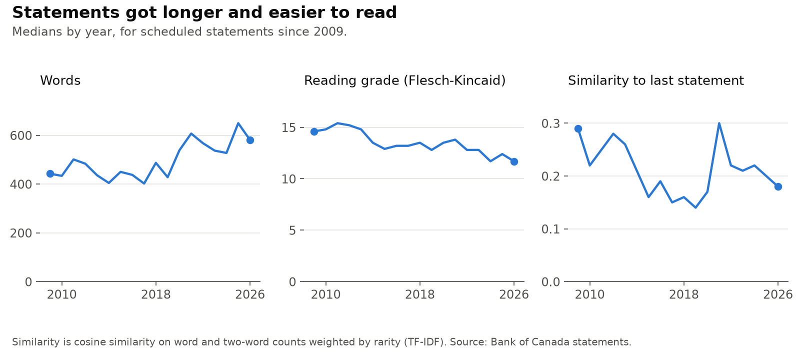
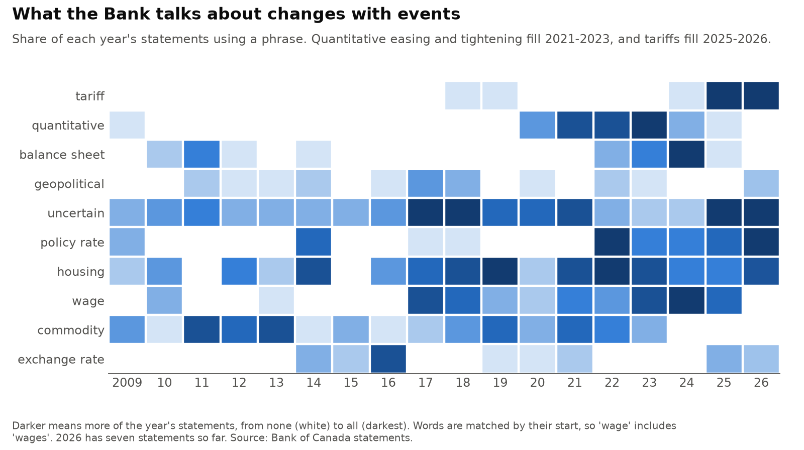
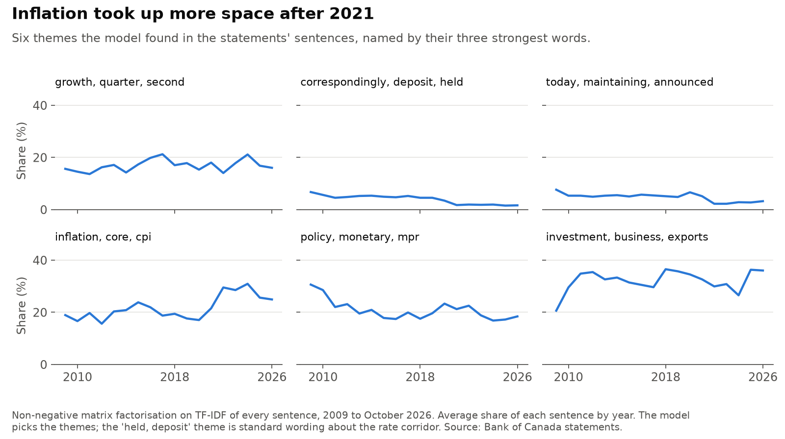
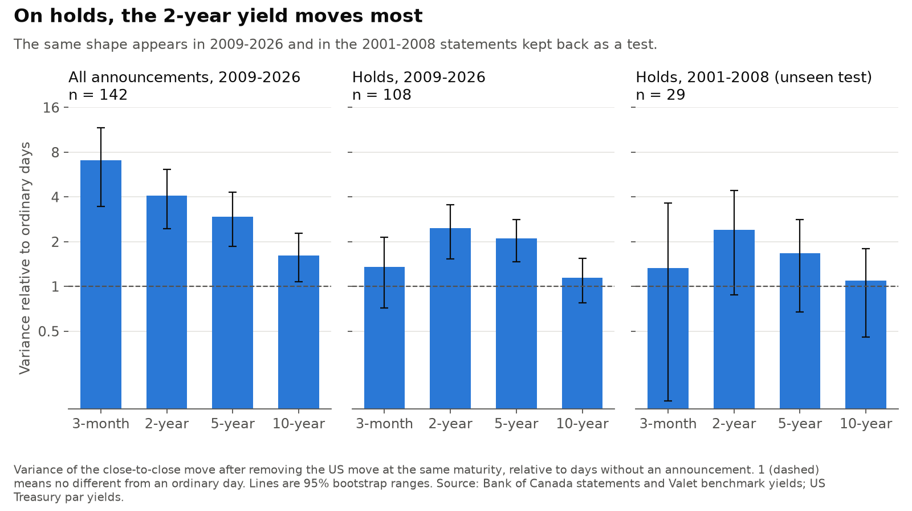
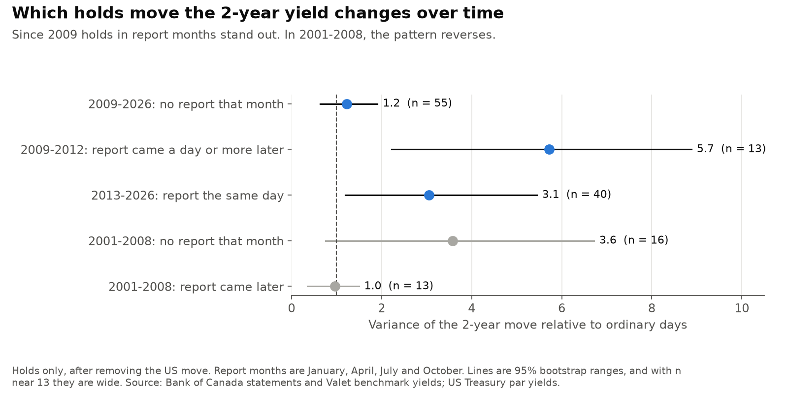
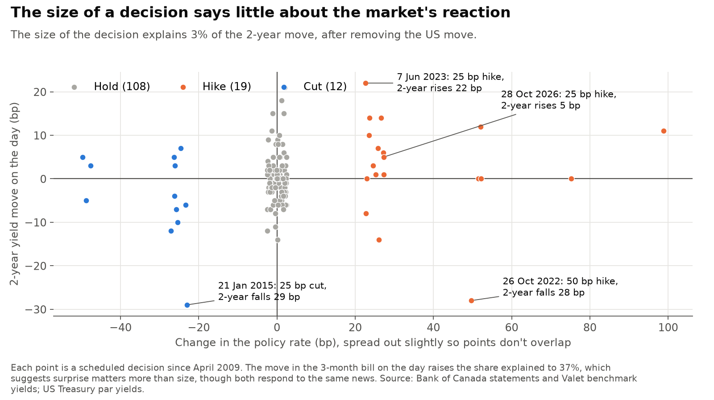
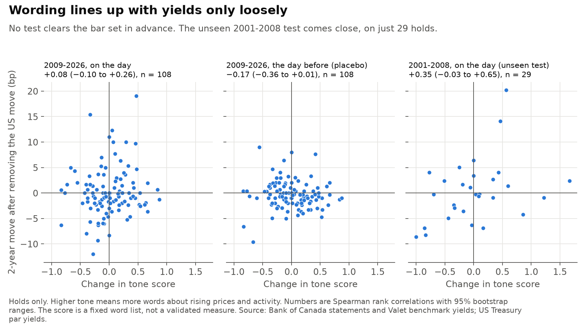

# boc_statements

[](https://github.com/atamalfuzi/boc_statements/actions/workflows/tests.yml)

How the Bank of Canada's language has changed since 2001, and when bond markets respond. It uses all 207 scheduled rate statements to October 2026, with text methods and an event study on free daily data. Python, with pandas and scikit-learn.

**[Write-up with an interactive chart](https://atamalfuzi.github.io/bank-of-canada-statements.html).**

**[Statement explorer](https://atamalfuzi.github.io/boc_statements/)**, rebuilt weekly: pick any statement to see what changed from the one before and how far the 2-year yield moved that day.

> **Personal project.** This is my own analysis of publicly available data. It is not associated with my work for any current or past employer and does not represent their views. It describes communication and markets. It is not investment advice, and it gives no trading signals, forecasts of decisions or verdicts on policy.

| Question | Methods | Answer |
|---|---|---|
| [How has the language changed?](#1-how-has-the-language-changed) | Phrase counts, TF-IDF similarity, topic model, reading grade | Longer and easier to read: 442.5 median words and grade 14.6 in 2009, 581 and 11.7 in 2026. Topics follow events. |
| [Which yields respond, and when?](#2-which-yields-respond-and-when) | Event study, US yield control, bootstrap | On holds, the 2-year moves most. That shape also appears in 2001-2008 statements kept back as a test. Which holds stand out changes over time. |
| [How much is already priced in?](#3-how-much-is-already-priced-in) | Regression on decision size, bill move, survey | Most of it. Decision size explains 3% of the 2-year move. |
| [Does a change in wording line up with the reaction?](#4-does-a-change-in-wording-line-up-with-the-reaction) | Fixed word list, placebo days, kept-back test, walk-forward | Not established. On holds, +0.08 in 2009-2026 and +0.35 in the 2001-2008 test, whose range includes zero. |

All ranges are 95%. A basis point (bp) is a hundredth of a percentage point.

## What it shows

### 1. How has the language changed?



Statements have grown from a median of 442.5 words in 2009 to 581 so far in 2026, with a high of 650 in 2025. The reading grade fell from 14.6 to 11.7, so they are longer but simpler.



Phrases follow events. Tariffs appear in every statement in 2025 and 2026. "Quantitative" appears in nearly all from 2021 to 2023 and fades after that.



A topic model finds six themes in the sentences. The inflation theme rises from about 18% of a statement's sentences in 2018-2019 to about 30% in 2022-2024.

### 2. Which yields respond, and when?



Across all announcements, the shorter the maturity, the bigger the response relative to an ordinary day: 7.0 times the variance for the 3-month bill and 1.6 times for the 10-year bond. Holds look different: the 3-month barely stands out (1.4), and the 2-year moves most (2.5, range 1.5 to 3.6). A hold says little about today's rate, so a response there is about the expected path of rates. The 2001-2008 statements show the same shape (1.3, 2.4, 1.7, 1.1), though their ranges are wide on 29 holds.



In the first look, holds with a Monetary Policy Report stood out and others didn't. That doesn't hold up as a general rule. Holds outside report months look ordinary since 2009 (1.2, range 0.6 to 1.9). Holds in report months stand out both when the report came out the same day (3.1) and in 2009-2012, when it came a day or more later (5.7), so the report's own publication isn't the whole story. In 2001-2008 the pattern reverses: holds outside report months have the larger ratio (3.6 against 1.0), with wide ranges.

### 3. How much is already priced in?



The size of a decision explains 3% of the 2-year move after removing the US move. A 50 bp hike on 26 October 2022 came with a 28 bp fall, and a 25 bp hike on 28 October 2026 came with a 5 bp rise. Adding the same day's move in the 3-month bill raises the share explained to 37%, which suggests that surprise matters more than size, though the two yields respond to the same news.

The Bank's Market Participants Survey gives another view of expectations. The median in the latest survey matched the actual rate at 18 of 30 meetings since 2023, and the gap between survey and outcome doesn't line up with the 2-year move (+0.09, range −0.27 to +0.45). The survey is quarterly and often months old by the meeting, so this is a weak measure of surprise.

### 4. Does a change in wording line up with the reaction?



The test is on holds, where the decision itself is no news. The tone score counts direction words in sentences about the economy, from a fixed list.

All 16 rows of [`output/tests.csv`](output/tests.csv) are below, whatever they show, as rank correlations with 95% ranges. The groups keep apart what was fixed in advance and what wasn't.

**Planned test: kept back, and tested after [the plan](ANALYSIS_PLAN.md) was committed**

| Sample | Comparison | Rank correlation | n |
|---|---|---|---:|
| **2001-2008** | **Holds: tone change vs 2-year move** | **+0.35 (−0.03 to +0.65)** | **29** |
| 2001-2008 | Holds: tone change vs move the day before (placebo) | −0.24 (−0.64 to +0.17) | 29 |
| 2001-2008 | Holds: tone change vs move the day after (placebo) | −0.20 (−0.57 to +0.18) | 29 |
| 2001-2008 | Holds: novelty vs size of move | +0.22 (−0.15 to +0.58) | 29 |

**First look: seen before the plan was written, and they shaped it, so they can't confirm themselves**

| Sample | Comparison | Rank correlation | n |
|---|---|---|---:|
| 2009-2026 | Holds: tone change vs 2-year move | +0.08 (−0.10 to +0.26) | 108 |
| 2009-2026 | Holds: tone change vs move the day before (placebo) | −0.17 (−0.36 to +0.01) | 108 |
| 2009-2026 | Holds: tone change vs move the day after (placebo) | −0.04 (−0.22 to +0.15) | 108 |
| 2009-2026 | All decisions: tone change vs 2-year move | +0.11 (−0.04 to +0.27) | 141 |
| 2009-2026 | All decisions: novelty vs size of move | +0.17 (+0.01 to +0.32) | 141 |
| 2017-2026 | Same-day move in USD/CAD vs 2-year move | −0.47 (−0.64 to −0.29) | 78 |
| 2017-2026 | Two-day move in USD/CAD vs 2-year move | −0.48 (−0.65 to −0.28) | 78 |

**After seeing results: periods and filters chosen after the first look, so leads at most**

| Sample | Comparison | Rank correlation | n |
|---|---|---|---:|
| 2009-2017 | Holds: tone change vs 2-year move | −0.10 (−0.32 to +0.13) | 62 |
| 2018-2026 | Holds: tone change vs 2-year move | +0.33 (+0.05 to +0.58) | 46 |
| 2018-2026 | Holds: tone change vs move the day before (placebo) | −0.16 (−0.43 to +0.11) | 46 |
| 2018-2026 | Holds: tone change vs move the day after (placebo) | +0.11 (−0.16 to +0.36) | 46 |
| 2021-2026 | Holds without a Fed decision that day: tone change vs 2-year move | +0.52 (+0.11 to +0.83) | 21 |

The plan said the idea would be supported only if the kept-back result had a range excluding zero and clearly smaller placebos. It missed on the range, so the answer is "not established". It may be real in some periods, but these data can't show it.

The largest number on wording, +0.52, is also the weakest evidence: 21 holds, in a sample cut after seeing the results, with no placebo days and a wide range. Like the 2018-2026 lead, it can only be tested on statements after 2 November 2026. In the first look, the day-before placebo is larger in size than the real result.

Five of the 16 ranges exclude zero, and with this many comparisons some will by chance. Two of the five are USD/CAD, a second market price that can move on the same news as the 2-year yield, so they say nothing about wording. The plan's other two tests compare variances rather than ranks, so they are in [`output/maturity.csv`](output/maturity.csv) and section 2.

A model that learns from the words themselves shows the risk. With more words than events, TF-IDF ridge regression gets an R² of 0.99 on past holds and −0.17 on later ones, worse than guessing the average. I left out a sentence classifier, because its labels would need someone other than the author of the test.

## Why daily data limits this

Free yield data is daily, and I found no openly licensed intraday source. A close-to-close window holds more than the statement:

- the Monetary Policy Report and press conference
- data releases
- Fed decisions, which fell on the same day as 9 of the last 15 announcements

The US 2-year yield explains about half of the Canadian 2-year's daily variance on ordinary days, so it is removed, but that control is imperfect. Daily data can compare groups of days. It can't credit one move to one statement. The median hold moves 2.0 bp against 1.3 bp on an ordinary day, and 5 holds out of 108 make up 42% of the squared moves.

## Other limits

- **Few events:** 108 holds since 2009 with yield data and 29 before. New statements arrive at eight a year.
- **Direction of cause:** wording and yields may both respond to the same news, so these are associations.
- **Changing vocabulary:** a list fixed today may not suit 2005 or 2015 equally. That may explain the different results by period, but this project can't test it.
- **Many comparisons:** some ranges will exclude zero by chance.
- **Lower bound:** short yields had little room to move in 2009-10 and 2020-21.
- **Data details:** yields are quoted to 1 bp, close to a typical move. Benchmark bonds change over time, which may create small jumps, and US and Canadian closes differ in time. Report months before 2013 assume the later-publication pattern seen in the pages I checked (2009-2012).
- **Scope:** unscheduled moves, such as March 2020, are left out.

## Data and terms

| Source | Use | Terms |
|---|---|---|
| [Bank of Canada statements](https://www.bankofcanada.ca/press/press-releases/) | Committed in `statements/statements.csv`, with page formatting and the closing information note removed | [Bank's terms](https://www.bankofcanada.ca/terms/): reuse with attribution and a note of changes |
| [Valet API](https://www.bankofcanada.ca/valet/docs): yields, bills, target rate, USD/CAD | Downloaded at run time; only moves on announcement days and summaries are published | Same. Bond and bill yields name CanDeal Data and Analytics as a source, so levels aren't republished here |
| [Market Participants Survey](https://www.bankofcanada.ca/2026/07/market-participants-survey-second-quarter-of-2026/) | Downloaded at run time, not committed | Bank's terms |
| [US Treasury par yields](https://home.treasury.gov/resource-center/data-chart-center/interest-rates/TextView?type=daily_treasury_yield_curve) | Downloaded at run time | US government data |
| [Federal Reserve meeting calendars](https://www.federalreserve.gov/monetarypolicy/fomccalendars.htm) | Dates only | US government data |

This work uses Bank of Canada content but isn't endorsed by the Bank. Montréal Exchange futures would measure surprises better, but its terms limit data to personal, non-commercial use, so they aren't used.

## Run it

```bash
pip install -r requirements-dev.txt
python data.py
python estimate.py
python figures.py
python site_data.py
python dashboard.py
pytest
```

`data.py` pauses two seconds between requests. The first run downloads about 70 files, and `statements.csv` already holds the statements. New statements fetched by the weekly build aren't committed, so results in `output/` stay as of November 2026 until someone reruns and commits them.

MIT licence for the code. Statement text belongs to the Bank of Canada.
